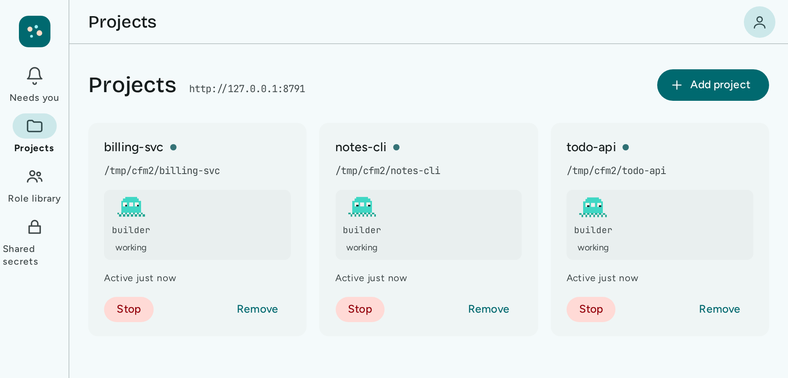
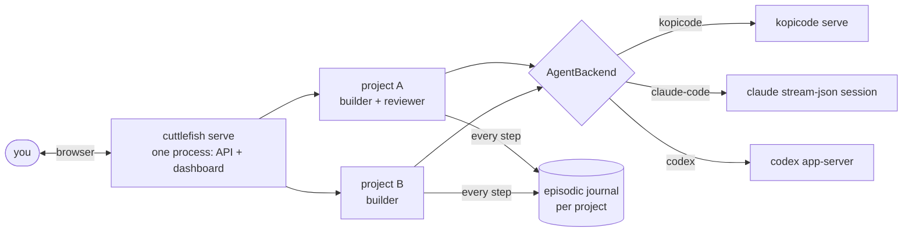

# cuttlefish-crew

Run a crew of coding agents across all your projects, and watch them from one dashboard. Register your repos, give
each project's agent a goal in plain language, and answer from the dashboard (or your phone) when one needs
permission. The coding itself is done by the agent CLI you already use:
[kopicode](https://github.com/leejianrong/kopicode), Claude Code or Codex, or any other terminal agent in a tmux
session. Everything that happens lands in one readable journal.



## Install

```bash
curl -fsSL https://raw.githubusercontent.com/leejianrong/cuttlefish-crew/main/scripts/install.sh | sh
cuttlefish serve
```

The script is short and commented, so read it first. It needs `git` and `curl`, installs uv and the `cuttlefish`
command into `~/.local/bin` with no sudo, builds the dashboard, and runs `cuttlefish doctor`. It names anything it
cannot install (Node 20.19+ or 22.12+, tmux, an agent CLI). Run it again to update; `sh install.sh --check` only
looks and `--uninstall` removes it ([ADR-0045](docs/adr/0045-a-one-line-install-clones-builds-the-dashboard-on-the-machine-and-never-uses-sudo.md)).
`cuttlefish serve` prints a URL and a token to paste in. From a checkout, `uv sync` then `make demo`.

Linux and WSL2 only (CI runs on Ubuntu; macOS is untested). cuttlefish makes no model call and needs no key of its
own, but the agent you pick does: a login for `claude` or `codex`, or `OPENROUTER_API_KEY` for kopicode.
Agents spend your model credit, usually cents for a small task.

## Three things to try first

1. **Add a project.** On Projects choose **Add project** and pick a git repo, or run
   `cuttlefish projects add --name myapp --root ~/code/myapp`.
2. **Give the builder a goal.** Open the project and type one in the box (for a Claude Code or Codex project; a kopicode project starts a team of roles instead, see the tutorial). The agent starts in its own tmux
   terminal with your goal as its first message. Switch on **Its own branch** and the goal runs in a new git
   worktree and branch, so your checkout is left alone ([ADR-0048](docs/adr/0048-each-goal-can-run-in-its-own-git-worktree-and-branch-inside-the-project-root.md)).
   When it is done, **Open a pull request** runs `gh pr create` with your own `gh` login and never merges
   ([ADR-0049](docs/adr/0049-a-goal-branch-opens-a-github-pull-request-through-the-machines-own-gh-and-never-merges.md)).
3. **Answer what needs you.** When an agent wants a command you have not approved, it stops and waits. Choose
   **Allow once**, **Always allow** or **Deny** in the **Needs you** tab. `sudo`, a forced `git push`, a download
   piped into a shell and writes outside the project are refused in every permission mode.


Want the whole walk-through, with two practice repos and two crews side by side? It is the
[tutorial](https://leejianrong.github.io/cuttlefish-crew/docs/tutorial/) (ten minutes). The
[quickstart](https://leejianrong.github.io/cuttlefish-crew/docs/quickstart/) is the short version.

## What else it does

- **Any agent, three first-class.** kopicode, Claude Code and Codex report status and ask for permission in the
  dashboard. Any other terminal agent (`cuttlefish projects add --terminal-command 'aider'`) runs in the same tmux
  session with a Terminal tab, but with no live status or Needs you cards ([ADR-0047](docs/adr/0047-a-project-can-run-any-terminal-command-in-its-tmux-session-with-no-status-integration.md)).
- **Survives a restart.** The core loop is a durable [satay](https://github.com/leejianrong/satay-runtime)
  workflow. Restart the fleet daemon and each project's in-flight team resumes. A one-shot `cuttlefish run` does not
  resume by itself: `--resume <id>` with the original arguments continues it.
- **A guarded `git push`.** A `git-push` preset (off unless declared) lets an agent push a named branch that is not
  the default one; the default branch and every force form are refused in every mode
  ([CLI reference](https://leejianrong.github.io/cuttlefish-crew/docs/cli-reference/)).
- **While you are away.** A [schedule](https://leejianrong.github.io/cuttlefish-crew/docs/schedules/) asks the
  builder for a goal on a repeat (`cuttlefish schedule add`, times in UTC); it never interrupts a goal in progress
  and plans first, so an unattended run waits at the plan for you. A
  [manager agent](https://leejianrong.github.io/cuttlefish-crew/docs/manager-tools/) can watch every project over
  MCP (`cuttlefish mcp --manager`), allow a command once or raise a decision for you, but cannot touch settings or
  secrets ([ADR-0050](docs/adr/0050-the-manager-credential-is-its-own-token-held-to-the-approve-tier-and-a-route-list.md)).
- **Secrets and keys.** An encrypted per-project secrets store, and an optional credential broker so an agent never
  holds its model key.
- **From a phone.** The dashboard is a web app you can pair through Tailscale https or a relay (checked in Chromium
  only).

How it compares with other fleet managers, including where it is behind:
[how we differ](https://leejianrong.github.io/cuttlefish-crew/docs/comparison/).



> **Status**: pre-1.0 and single-operator (one shared password, no per-user accounts).
> [`AGENTS.md`](AGENTS.md) and [`agent_docs/known-gaps.md`](agent_docs/known-gaps.md) list what is shipped and the
> gaps that are known and accepted.

## Usage from the command line

Run one task against the repo you are standing in (`--root` picks another):

```bash
export CUTTLEFISH_AGENT_BACKEND=codex     # or kopicode (default), claude-code
cuttlefish run "add a .gitignore entry for build artifacts"
cuttlefish show <task-id>                 # the id `run` prints
```

State goes to `.cuttlefish/` and `.satay/` in the directory you run from; add both to your `.gitignore`. Not sure
your setup is right? `cuttlefish doctor` checks the agent CLI and its login, and `cuttlefish init` registers the
repo as a project. `run-team`, `--steerable`, `--require-approval` and every other flag are in the
[CLI reference](https://leejianrong.github.io/cuttlefish-crew/docs/cli-reference/).

## Configuration

| Variable | Default | What it does |
|---|---|---|
| `CUTTLEFISH_AGENT_BACKEND` | `kopicode` | `kopicode`, `claude-code`, or `codex`; a project or role can override it. |
| `CUTTLEFISH_SANDBOX` | `none` | `none`, `container` (local Docker), or `e2b`. |
| `CUTTLEFISH_SECRETS_KEY` | unset | Turns on the encrypted, project-scoped secrets store. Must be a Fernet key. |
| `CUTTLEFISH_CREDENTIAL_BROKER` | unset | `1` keeps each agent's model key in the daemon and leases the agent a short-lived token. |
| `CUTTLEFISH_REQUEST_WINDOW` | `600` | Seconds you have to answer a Needs you request before it is denied. |
| `CUTTLEFISH_LOG_LEVEL` | `INFO` | How much `cuttlefish serve` logs, to the terminal and `~/.cuttlefish/logs/cuttlefish.log`. |

Every other variable (transports, local model endpoints, resume, turn and token limits, the agent environment
allowlist) is in the [configuration table](https://leejianrong.github.io/cuttlefish-crew/docs/cli-reference/#configuration).
Known limits to read before spending money (Codex reports no cost, so only a token limit stops it; Stop takes
effect at the end of the current round) are in [`agent_docs/known-gaps.md`](agent_docs/known-gaps.md).

## Documentation

[Docs site](https://leejianrong.github.io/cuttlefish-crew/docs/) (quickstart, tutorial, CLI reference,
architecture, how we differ) · [`docs/PLAN.md`](docs/PLAN.md) (where this is headed) ·
[`docs/adr/`](docs/adr/) (why each decision was made) · [`docs/research/`](docs/research/) (competitor comparison).

## Contributing

There is no `CONTRIBUTING.md`; [`AGENTS.md`](AGENTS.md) is the contributor guide (toolchain, branch and PR workflow,
and the architectural boundaries). `main` is PR-only and `make ci` must pass. Issues and questions:
[GitHub issues](https://github.com/leejianrong/cuttlefish-crew/issues).

Built with [kopicode](https://github.com/leejianrong/kopicode) (the reference coding agent) and
[satay-runtime](https://github.com/leejianrong/satay-runtime) (the durable runtime).

## Licence

Apache-2.0. See [LICENSE](LICENSE).
